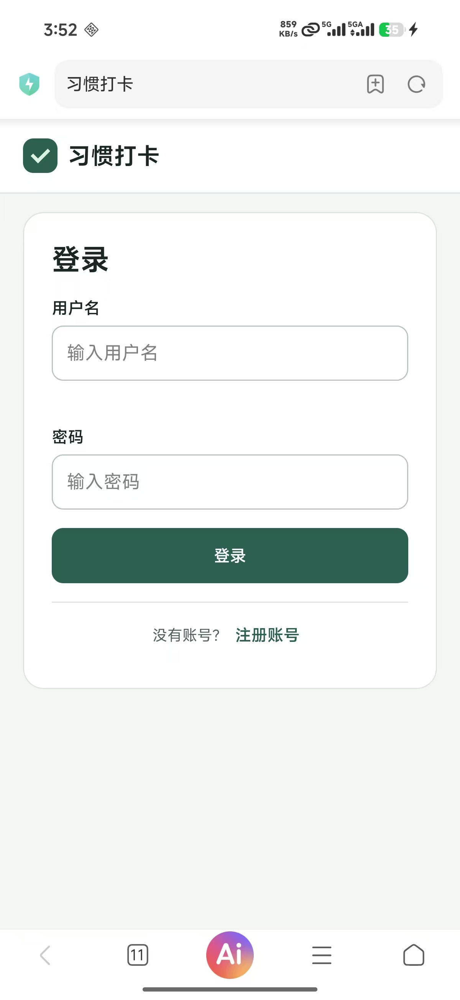
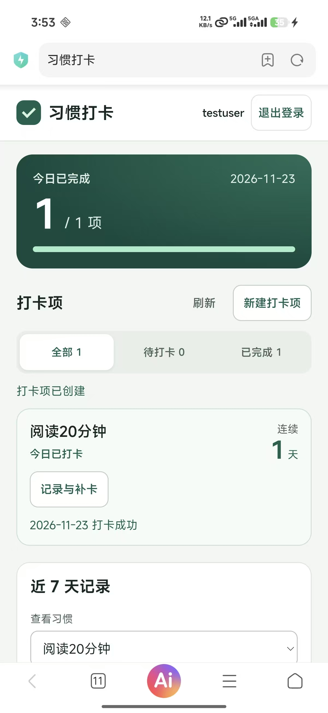
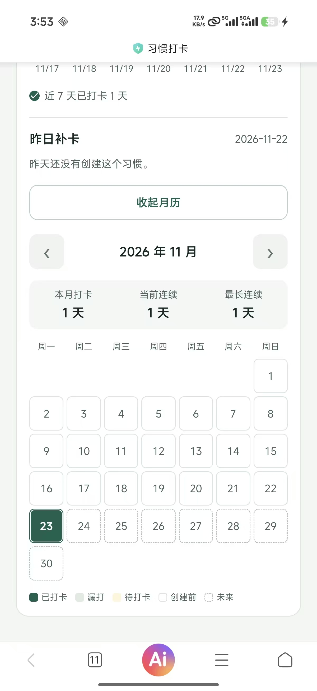

# Uniapp-Web
Uniapp+Web后端打卡应用

本项目对应 KUAFUAI 开发实习题 **选项 B · 全栈应用**。用户在 UniApp H5 登录、创建习惯、每天打卡并查看该习惯的连续天数。项目采用 Vue 3、Spring Boot、MySQL 和 Redis。

H5 通过 Nginx 调用 Spring Boot。MySQL 保存用户、打卡项和每日打卡记录，Redis 保存登录会话并缓存打卡状态和连续天数。

## 快速启动

启动 Docker Desktop（Linux 容器模式），或在 Linux 上启动 Docker Engine 并安装 Compose 插件。用 `docker info` 和 `docker compose version` 确认可用，确认 `docker compose run --help` 支持 `--env-from-file`，并让本机的 `5173`、`8080` 端口空闲。前端、API、MySQL 和 Redis 都由 Compose 启动，Node.js、JDK 和 Maven 也在容器内使用。第一次拉取镜像和下载构建依赖的时间取决于网络与缓存。

已下载代码包可直接进入含 `compose.yaml` 的目录。从 GitHub 获取代码时，用当前项目分支克隆。

```sh
git clone --branch codex/development-plan https://github.com/Lxc03/Uniapp-Web.git
cd Uniapp-Web
```

### 生成环境文件

在包含 `compose.yaml` 的目录执行。脚本只在缺少 `.env` 时创建该文件，并随机生成容器内 MySQL 应用用户、MySQL 管理员和 Redis 的密码。默认模式与电脑上已有的 MySQL 账号、密码和 `3306` 端口配置相互独立。

Windows 使用 PowerShell。

```powershell
if (-not (Test-Path -LiteralPath .env)) {
    $settings = Get-Content -Raw .env.example
    $settings = $settings.Replace('replace_with_db_name', 'uniapp_web').Replace('replace_with_db_user', 'uniapp_app')
    foreach ($key in 'db_password', 'db_root_password', 'redis_password') {
        $settings = $settings.Replace("replace_with_$key", [guid]::NewGuid().ToString('N'))
    }
    Set-Content -Encoding ascii -LiteralPath .env -Value $settings
}
```

macOS 或 Linux 使用终端。下例用 `openssl` 生成密码，也可按[配置说明](#配置说明)手动填写。

```sh
if [ ! -f .env ]; then
  (
    set -e
    umask 077
    db_password=$(openssl rand -hex 16)
    root_password=$(openssl rand -hex 16)
    redis_password=$(openssl rand -hex 16)
    sed -e 's/replace_with_db_name/uniapp_web/' \
        -e 's/replace_with_db_user/uniapp_app/' \
        -e "s/replace_with_db_password/$db_password/" \
        -e "s/replace_with_db_root_password/$root_password/" \
        -e "s/replace_with_redis_password/$redis_password/" .env.example > .env
  )
fi
```

### 启动并登录

```sh
docker compose -p uniapp-web --env-file .env up -d --build
```

打开[就绪检查](http://localhost:5173/api/ready)，服务刚启动时可以稍等片刻再刷新。看到 `{"status":"ready","mysql":"up","redis":"up"}` 后，按[初始化账号并登录](#初始化账号并登录)生成演示账号，再打开首页登录。[H5 首页](http://localhost:5173/)

若启动或就绪检查失败，在同一目录查看容器状态和日志。用完可执行 `docker compose -p uniapp-web --env-file .env stop`，MySQL 数据会保存在命名卷中。

```sh
docker compose -p uniapp-web --env-file .env ps
docker compose -p uniapp-web --env-file .env logs --tail=80 frontend api mysql redis
```

## 项目结构

| 路径 | 用途 |
| --- | --- |
| `frontend/` | UniApp Vue 3 H5 CLI 工程，使用 Node 22 构建，由 Nginx 提供页面和 `/api` 代理 |
| `backend/` | Spring Boot 3.5.16 应用，使用 Maven 和 JDK 21 构建 |
| `compose.yaml` | 编排 `frontend`、`api`、`mysql` 和 `redis` |
| `compose.local-mysql.yaml` | 可选的本机 MySQL 验收配置，使用单独的 H5/API 端口 |
| `.env.example` | MySQL 和 Redis 的本地配置样例 |

## 配置说明

手动配置时，在仓库根目录复制 `.env.example` 为 `.env`，按下表替换五个占位值。MySQL 初始化变量在空数据卷首次启动时生效。后续请复用与现有数据卷匹配的 `.env`。已有库要更换密码时，先用 MySQL 管理员执行 `ALTER USER`，再同步修改 `.env` 并执行 `docker compose -p uniapp-web --env-file .env up -d` 让新配置生效。`.env` 受 Git 忽略。[MySQL 镜像初始化说明](https://github.com/docker-library/docs/tree/master/mysql#environment-variables)

| `.env` 配置项 | 用途 |
| --- | --- |
| `MYSQL_DATABASE` | 容器内的应用库，快速启动使用 `uniapp_web` |
| `MYSQL_USER` | API 使用的普通数据库用户，快速启动使用 `uniapp_app` |
| `MYSQL_PASSWORD` | `MYSQL_USER` 的密码 |
| `MYSQL_ROOT_PASSWORD` | 容器内 MySQL 的管理员密码 |
| `REDIS_PASSWORD` | Redis 和 API 共用的认证密码 |

```powershell
docker compose -p uniapp-web --env-file .env config --quiet
docker compose -p uniapp-web --env-file .env pull mysql redis
docker compose -p uniapp-web --env-file .env build frontend api
docker compose -p uniapp-web --env-file .env up -d --no-build
docker compose -p uniapp-web --env-file .env ps
```

MySQL 和 Redis 通过 Compose 网络访问，连接参数按服务注入。MySQL 数据保存在 `uniapp-web_mysql_data` 命名卷。

## 初始化账号并登录

API 启动时用 Flyway 迁移数据库。就绪后，在同一目录按对应系统执行命令。Windows 使用 PowerShell。首次生成两个不同的演示密码，后续运行复用 Git 忽略的 `.env.demo`。

```powershell
if (-not (Test-Path -LiteralPath .env.demo)) {
    @(
        "DEMO_A_PASSWORD=$([guid]::NewGuid().ToString('N'))"
        "DEMO_B_PASSWORD=$([guid]::NewGuid().ToString('N'))"
    ) | Set-Content -Encoding ascii .env.demo
}
docker compose -p uniapp-web --env-file .env run --rm --no-deps --env-from-file .env.demo api --spring.main.web-application-type=none --spring.profiles.active=demo-init
if ($LASTEXITCODE -ne 0) { throw '演示账号初始化失败。' }
```

macOS 或 Linux 使用终端。

```sh
if [ ! -f .env.demo ]; then
  (
    set -e
    umask 077
    demo_a_password=$(openssl rand -hex 16)
    demo_b_password=$(openssl rand -hex 16)
    printf 'DEMO_A_PASSWORD=%s\nDEMO_B_PASSWORD=%s\n' "$demo_a_password" "$demo_b_password" > .env.demo
  )
fi
docker compose -p uniapp-web --env-file .env run --rm --no-deps --env-from-file .env.demo api --spring.main.web-application-type=none --spring.profiles.active=demo-init
```

初始化只在单次运行的容器中读取演示密码。由 MySQL 唯一索引处理重复执行，保留原账号 ID 和密码摘要。

用本地编辑器查看 `.env.demo`。账号 `demo_a` 对应 `DEMO_A_PASSWORD`，`demo_b` 对应 `DEMO_B_PASSWORD`。打开首页，用其中一个账号登录。[H5 首页](http://localhost:5173/)

点击「新建打卡项」创建「阅读」，再点「打今日卡」。确认卡片显示「今日已打卡」、连续 1 天，并且今日完成数增加 1。刷新后状态应保持。验证服务端防重时，在浏览器 Network 中重发当天的打卡 POST。首次返回 `201`，重复请求返回 `200`，两个响应包含同一个打卡记录 ID。会话有效期从登录起固定为 30 分钟。

本地 Compose 公开来源默认为 `http://localhost:5173`。通过 HTTPS 代理部署时，用 `AUTH_PUBLIC_ORIGIN` 指定实际公开来源，并设置 `AUTH_COOKIE_SECURE=true`。

## 使用本机 MySQL 验收

需要接入电脑上已有的 MySQL 时，使用 Docker Desktop 和 Compose 2.24.4 或更新版本加载 `compose.local-mysql.yaml`。此模式通过 `host.docker.internal:3306` 访问宿主机 MySQL，只启动 H5、API 和 Redis。H5 使用 `127.0.0.1:5174`，API 使用 `127.0.0.1:8081`。[Docker Desktop 宿主机网络](https://docs.docker.com/desktop/features/networking/networking-how-tos/#connect-a-container-to-a-service-on-the-host) · [Compose 覆盖语法](https://docs.docker.com/reference/compose-file/merge/#replace-value)

### 创建验收库和应用账号

在本机用 `mysql -u root -p` 或 MySQL 客户端登录管理员账号。`root` 和 `123456` 只适用于恰好如此配置的本机数据库。如果你的管理员账号或密码不同，在这一登录步骤使用实际凭据。然后创建一个独立的验收库和应用账号，把示例密码换成自己设置的密码。也可以复用已有的普通账号，只要它允许 Docker Desktop 发起的连接，并有权限在所选库里执行 Flyway 迁移和应用读写。[MySQL 创建账号和授权说明](https://dev.mysql.com/doc/refman/8.4/en/creating-accounts.html)

```sql
CREATE DATABASE IF NOT EXISTS uniappreview CHARACTER SET utf8mb4;
CREATE USER 'uniapp_local_app'@'%' IDENTIFIED BY 'replace_with_your_app_password';
GRANT ALL PRIVILEGES ON uniappreview.* TO 'uniapp_local_app'@'%';
```

示例使用 `%` 匹配 Docker Desktop 的连接来源，授权范围为 `uniappreview` 库。若本机数据库有固定的容器访问范围，可将两个语句中的 `%` 都换成对应来源。若账号已存在，跳过 `CREATE USER`，使用该账号的实际密码。

### 填写连接信息并启动

按[环境文件步骤](#生成环境文件)准备 `.env`，再在同一目录新建 `.env.local-mysql`。把下面三个值填写为实际库名、应用用户名和应用密码。密码中的 `$` 等字符可用单引号包起来，按字面值读取。两个文件均受 Git 忽略。[Compose 环境文件语法](https://docs.docker.com/compose/how-tos/environment-variables/variable-interpolation/#env-file-syntax)

```dotenv
LOCAL_MYSQL_DATABASE=uniappreview
LOCAL_MYSQL_USERNAME=uniapp_local_app
LOCAL_MYSQL_PASSWORD='replace_with_your_app_password'
```

在仓库根目录用 PowerShell 启动。Flyway 会在上述数据库创建应用表。如果 MySQL 使用其他端口，先创建本地 `.temp/` 目录，把 `compose.local-mysql.yaml` 复制进去。在副本的 `SPRING_DATASOURCE_URL` 中把 `3306` 改为实际端口，再把下方第二个 `-f` 指向 `.temp/compose.local-mysql.yaml`。

```powershell
$localCompose = @('-f', 'compose.yaml', '-f', 'compose.local-mysql.yaml', '--env-file', '.env', '--env-file', '.env.local-mysql', '-p', 'uniapp-web-local-mysql')
docker compose @localCompose config --quiet
if ($LASTEXITCODE -ne 0) { throw 'Compose 配置检查失败。' }
docker compose @localCompose up -d --build
if ($LASTEXITCODE -ne 0) { throw 'Compose 启动失败。' }
curl.exe --noproxy "*" --fail --silent --show-error --retry 30 --retry-all-errors --retry-delay 2 --retry-max-time 90 --max-time 4 http://127.0.0.1:5174/api/ready
```

就绪后，为这个验收库单独创建 `.env.local-mysql.demo`，变量格式与[初始化账号](#初始化账号并登录)中的 `.env.demo` 相同。用以下命令初始化账号，再用 `demo_a` 或 `demo_b` 和对应密码登录。请用 `http://127.0.0.1:5174/` 打开页面，该主机名与默认 `localhost:5173` 的浏览器会话分开。[本机 MySQL 验收首页](http://127.0.0.1:5174/)

```powershell
docker compose @localCompose run --rm --no-deps --env-from-file .env.local-mysql.demo api --spring.main.web-application-type=none --spring.profiles.active=demo-init
```

若未就绪，用 `docker compose @localCompose logs --tail=80 api redis` 查看原因。`Access denied` 时核对 `.env.local-mysql` 的账号、密码和授权来源。连不上时确认宿主机 MySQL 正在运行，并检查监听端口和防火墙是否允许 Docker Desktop 访问。用 `docker compose @localCompose stop` 停止验收环境，宿主机 MySQL 继续运行。

### 验证会话失效和恢复

按下文的独立复跑步骤启动测试项目。在测试 Redis 中对比登录前后的 `auth:session:v1:*`，把新增的测试会话键放入 `$testSessionKey`。刷新浏览器后查看 TTL，应继续下降。缩短该测试键的有效期后，等 TTL 返回 `-2` 再刷新，Network 中的 `GET /api/auth/me` 应返回会话失效的 401。

```powershell
docker compose -p $projectName --env-file $envFile exec -T redis redis-cli --raw TTL $testSessionKey
docker compose -p $projectName --env-file $envFile exec -T redis redis-cli --raw EXPIRE $testSessionKey 2
```

重新登录后，按「演练与恢复」的命令暂停并启动测试项目的 Redis。暂停期间刷新 H5，`/api/auth/me` 应返回 503，页面显示重试。恢复后再次验证登录。验收记录保留 HTTP 状态、业务码和 TTL 数字，对 Cookie 与会话键脱敏。

## Android 真机演示

2026 年 11 月 23 日，在 Xiaomi 17 Pro Max 的系统浏览器中，通过 USB 和 `adb reverse` 访问本地开发版本的 H5，完成了登录、创建「阅读20分钟」、打卡和查看月历。手机访问的 `http://localhost:5173/` 由 Nginx 提供页面，并通过同源 `/api` 调用后端。

| ① 手机打开登录页 | ② 登录后创建习惯并打卡 | ③ 查看近 7 天记录和月历 |
| --- | --- | --- |
|  |  |  |
| 手机浏览器显示登录表单和注册入口。 | 「阅读20分钟」显示今日已打卡，今日完成 `1 / 1`，连续 `1 天`。 | 11 月 23 日在月历标记为已打卡。本月打卡、当前连续和最长连续均为 `1 天`。昨天早于习惯创建日，页面说明了无法补卡的原因。 |

当前分支的启动验收按上文初始化演示账号，登录后验证创建习惯、今日打卡和连续天数。

## 验证就绪

打开 [H5 首页](http://localhost:5173/)。首次启动时，H5 可能早于 API 就绪，Network 中会短暂出现 502。页面出现服务提示时点击「重新检查」。在 Network 中确认同源 `GET /api/ready` 返回 200，服务提示随即消失。

以下两条实测命令分别检查直连 API 和 Nginx 代理。

```powershell
curl.exe --noproxy "*" -i http://localhost:8080/api/ready
curl.exe --noproxy "*" -i http://localhost:5173/api/ready
```

API 执行 MySQL `SELECT 1` 和 Redis `PING`。两项都通过时返回 HTTP 200 和 `{"status":"ready","mysql":"up","redis":"up"}`。任一失败时返回 HTTP 503，`status` 为 `not_ready`，失败依赖为 `down`。

## 演练与恢复

在本项目的测试环境中，一次停止一个依赖并复查代理地址。每次恢复后等同一地址返回 HTTP 200，再开始下一项。

```powershell
docker compose -p uniapp-web --env-file .env stop mysql
curl.exe --noproxy "*" -i http://localhost:5173/api/ready
docker compose -p uniapp-web --env-file .env start mysql
```

MySQL 停止期间返回 HTTP 503，状态为 `mysql=down`、`redis=up`。启动后重复请求代理地址，确认恢复 200。

```powershell
docker compose -p uniapp-web --env-file .env stop redis
curl.exe --noproxy "*" -i http://localhost:5173/api/ready
docker compose -p uniapp-web --env-file .env start redis
```

Redis 停止期间返回 HTTP 503，状态为 `mysql=up`、`redis=down`。启动后重复请求代理地址，确认恢复 200，再点击 H5 的「重试登录状态」。上述 `stop` 和 `start` 操作会保留容器及 MySQL 命名卷。

## 独立复跑与验证数据卷

选一个未使用的 Compose 项目名，复制配置样例到独立的本地文件，并填写该测试库的配置。后续对测试项目统一使用这对项目名和配置文件。

```powershell
$projectName = 'uniapp-web-p04'
$envFile = '.env.p04'
Copy-Item .env.example $envFile
```

先按上文顺序执行 `config --quiet`、`pull mysql redis` 和 `build frontend api`，将命令中的 `-p uniapp-web --env-file .env` 替换为 `-p $projectName --env-file $envFile`。如果原项目占用 5173 或 8080，记录其运行服务，再用原项目的项目名和配置文件执行 `docker compose -p uniapp-web --env-file .env stop`。

```powershell
docker compose -p $projectName --env-file $envFile up -d --no-build
docker compose -p $projectName --env-file $envFile ps
```

按上文验收 H5 就绪。在独立测试库写入校验记录，使用应用账号查询并记下返回值。可以把待执行的 SQL 放入 `$sql`，再通过 MySQL 容器的应用账号执行。

```powershell
$sql | docker compose -p $projectName --env-file $envFile exec -T mysql sh -c 'MYSQL_PWD="$MYSQL_PASSWORD" exec mysql --user="$MYSQL_USER" --database="$MYSQL_DATABASE" --batch --raw --skip-column-names'
docker compose -p $projectName --env-file $envFile down
docker volume inspect "${projectName}_mysql_data" --format '{{.Name}}'
docker compose -p $projectName --env-file $envFile up -d --no-build
```

普通 `down` 会保留命名卷。重新启动后，用同一应用账号查回原记录并复查 H5。复跑结束时，用普通 `down` 释放测试项目的端口，然后用原项目的项目名和配置文件执行 `start` 启动原先运行的服务，复查就绪。

检查必填项时，另复制一份样例，删除其中的 `REDIS_PASSWORD` 赋值，并在该变量未设置的终端中对这份副本运行 `config --quiet`。预期命令失败且指出 `REDIS_PASSWORD`。
